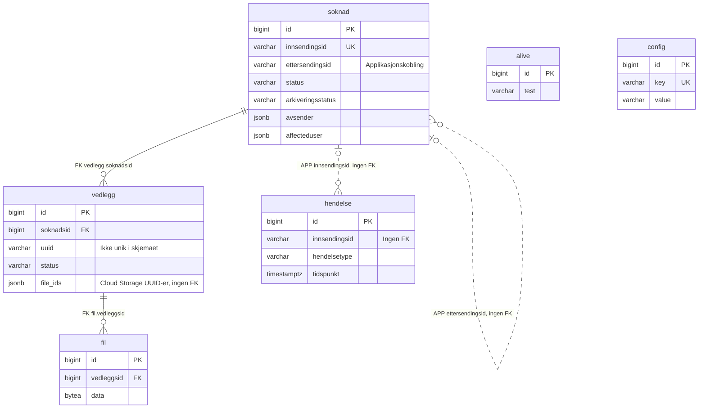

# Databaseskjema

Databasen i innsending-api lagrer søknader, vedleggsmetadata, filer, hendelser og driftsinnstillinger.

## Oversikt

Applikasjonen bruker PostgreSQL 18 og Spring Data JPA til å lese og skrive data. Flyway kjører nye migreringer ved oppstart og holder oversikt over hvilke som er kjørt.

Søknads- og vedleggsmetadata ligger i databasen. Filinnhold lagres både i tabellen `fil` og i Cloud Storage. PostgreSQL-lagringen brukes fortsatt til nye dokumenter, og enkelte hoveddokumenter finnes begge steder. `vedlegg.file_ids` inneholder filreferanser til Cloud Storage, ikke til `fil.id`.

## Relasjoner

Heltrukne relasjoner er fremmednøkler. Stiplede relasjoner er koblinger som applikasjonen håndterer uten fremmednøkkel.

En søknad kan ha flere vedlegg, og et vedlegg kan ha flere filer. `ettersendingsid` viser normalt til den opprinnelige innsendingen, men settes til søknadens egen `innsendingsid` når en ettersending opprettes uten en tidligere innsending. Hendelser knyttes til søknader med `innsendingsid` og kan beholdes etter at søknaden er slettet. `alive` og `config` har ingen relasjoner til de andre tabellene.

## Tabeller

`NULL` angir om kolonnen kan være tom. `Ingen` betyr at kolonnen ikke har SQL-default. `timestamptz` er tidspunkt med tidssone. `UTC-uttrykk` viser til SQL-defaulten `(now() at time zone 'UTC')`.

### soknad

Metadata om søknaden, hvem den gjelder, avsender, status og frister.

| Kolonne | Type | NULL | SQL-default | Beskrivelse |
| --- | --- | --- | --- | --- |
| `id` | `bigint` | Nei | Sekvens | Primærnøkkel |
| `innsendingsid` | `varchar(255)` | Nei | Ingen | Unik innsendings-ID |
| `tittel` | `varchar(255)` | Ja | Ingen | Søknadstittel |
| `skjemanr` | `varchar(20)` | Ja | Ingen | Skjemanummer |
| `tema` | `varchar(10)` | Ja | Ingen | Tema |
| `spraak` | `varchar(10)` | Ja | Ingen | Språkkode |
| `status` | `varchar(255)` | Ja | Ingen | Søknadsstatus |
| `brukerid` | `varchar(11)` | Ja | Ingen | Brukeridentifikator |
| `ettersendingsid` | `varchar(255)` | Ja | Ingen | Kobling til opprinnelig innsending |
| `opprettetdato` | `timestamptz` | Nei | UTC-uttrykk | Opprettet |
| `endretdato` | `timestamptz` | Nei | UTC-uttrykk | Sist endret |
| `innsendtdato` | `timestamptz` | Ja | Ingen | Innsendingstidspunkt |
| `visningssteg` | `integer` | Ja | Ingen | Steg i brukerflaten |
| `visningstype` | `varchar(40)` | Ja | Ingen | Visningsmodus for søknaden |
| `kanlasteoppannet` | `boolean` | Ja | Ingen | Om andre vedlegg kan lastes opp |
| `forsteinnsendingsdato` | `timestamptz` | Ja | Ingen | Første innsending i ettersendingsløpet |
| `ettersendingsfrist` | `integer` | Ja | `14` | Frist i dager |
| `arkiveringsstatus` | `varchar` | Nei | `'IkkeSatt'` | Arkiveringsstatus |
| `applikasjon` | `varchar(255)` | Ja | Ingen | Klientapplikasjon |
| `skalslettesdato` | `timestamptz` | Ja | Ingen | Planlagt sletting |
| `ernavopprettet` | `boolean` | Ja | Ingen | Om Nav opprettet søknaden |
| `brukertype` | `varchar(255)` | Ja | Ingen | Type brukeridentifikator |
| `affecteduser` | `jsonb` | Ja | Ingen | Brukeren søknaden gjelder |
| `avsender` | `jsonb` | Ja | Ingen | Avsender |
| `grantuserdigitalaccess` | `boolean` | Ja | Ingen | Ønske om digital tilgang |

### vedlegg

Metadata om hoveddokumenter og vedlegg, opplastingsstatus og filreferanser.

| Kolonne | Type | NULL | SQL-default | Beskrivelse |
| --- | --- | --- | --- | --- |
| `id` | `bigint` | Nei | Sekvens | Primærnøkkel |
| `soknadsid` | `bigint` | Nei | Ingen | Fremmednøkkel til `soknad.id` |
| `status` | `varchar(255)` | Ja | Ingen | Opplastingsstatus |
| `erhoveddokument` | `boolean` | Ja | Ingen | Hoveddokument |
| `ervariant` | `boolean` | Ja | Ingen | Alternativ dokumentvariant |
| `erpdfa` | `boolean` | Ja | Ingen | PDF/A-markering |
| `vedleggsnr` | `varchar(255)` | Ja | Ingen | Vedleggskode |
| `tittel` | `varchar(255)` | Ja | Ingen | Tittel |
| `mimetype` | `varchar(255)` | Ja | Ingen | Dokumentformat |
| `uuid` | `varchar(255)` | Ja | Ingen | Ekstern vedleggsidentifikator |
| `opprettetdato` | `timestamptz` | Nei | UTC-uttrykk | Opprettet |
| `endretdato` | `timestamptz` | Nei | UTC-uttrykk | Sist endret |
| `vedleggsurl` | `varchar(255)` | Ja | Ingen | URL til skjema for vedlegget |
| `erpakrevd` | `boolean` | Ja | Ingen | Påkrevd vedlegg |
| `label` | `varchar(250)` | Ja | Ingen | Etikett |
| `beskrivelse` | `varchar(4000)` | Ja | Ingen | Beskrivelse |
| `innsendtdato` | `timestamptz` | Ja | Ingen | Når vedlegget ble sendt inn |
| `formioid` | `varchar(255)` | Ja | Ingen | Formio-komponentidentifikator |
| `opplastingsvalgkommentarledetekst` | `varchar(255)` | Ja | Ingen | Ledetekst for kommentar |
| `opplastingsvalgkommentar` | `varchar(255)` | Ja | Ingen | Kommentar til opplastingsvalg |
| `file_ids` | `jsonb` | Ja | Ingen | Liste med Cloud Storage-fil-ID-er |

### fil

Filnavn, format, størrelse og binært filinnhold lagret i PostgreSQL. Hver fil tilhører et vedlegg.

| Kolonne | Type | NULL | SQL-default | Beskrivelse |
| --- | --- | --- | --- | --- |
| `id` | `bigint` | Nei | Sekvens | Primærnøkkel |
| `vedleggsid` | `bigint` | Nei | Ingen | Fremmednøkkel til `vedlegg.id` |
| `filnavn` | `varchar(255)` | Ja | Ingen | Filnavn |
| `mimetype` | `varchar(255)` | Ja | Ingen | Filformat |
| `data` | `bytea` | Ja | Ingen | Binært filinnhold |
| `opprettetdato` | `timestamptz` | Nei | UTC-uttrykk | Opprettet |
| `storrelse` | `integer` | Ja | Ingen | Byteantall |
| `antallsider` | `integer` | Ja | Ingen | Sideantall |

### hendelse

Hendelser i søknadsflyten, som opprettelse, innsending, arkivering og sletting. SQL-operasjoner logges separat gjennom [pgAudit](auditlogging.md).

| Kolonne | Type | NULL | SQL-default | Beskrivelse |
| --- | --- | --- | --- | --- |
| `id` | `bigint` | Nei | Sekvens | Primærnøkkel |
| `innsendingsid` | `varchar(255)` | Nei | Ingen | Innsendings-ID |
| `hendelsetype` | `varchar(255)` | Nei | Ingen | Type hendelse |
| `tidspunkt` | `timestamptz` | Nei | UTC-uttrykk | Hendelsestidspunkt |
| `skjemanr` | `varchar(20)` | Ja | Ingen | Skjemanummer |
| `erettersending` | `boolean` | Ja | Ingen | Om søknaden er en ettersending |
| `tema` | `varchar(10)` | Ja | Ingen | Tema |
| `applikasjon` | `varchar(255)` | Ja | Ingen | Klientapplikasjon |

### alive

En testverdi som applikasjonen leser for å kontrollere databaseforbindelsen. Tabellen opprettes med verdien `ok`.

| Kolonne | Type | NULL | SQL-default | Beskrivelse |
| --- | --- | --- | --- | --- |
| `id` | `bigint` | Nei | Sekvens | Primærnøkkel |
| `test` | `varchar(2)` | Ja | Ingen | Testverdi |

### config

Driftsinnstillinger for uinnlogget innsending, blant annet hovedbryter og grenser for opplastinger og innsendinger.

| Kolonne | Type | NULL | SQL-default | Beskrivelse |
| --- | --- | --- | --- | --- |
| `id` | `bigint` | Nei | `GENERATED ALWAYS AS IDENTITY` | Primærnøkkel |
| `key` | `varchar(64)` | Nei | Ingen | Unik innstillingsnøkkel |
| `value` | `varchar(32)` | Ja | Ingen | Innstillingsverdi som tekst |
| `created_at` | `timestamptz` | Nei | UTC-uttrykk | Opprettet |
| `modified_at` | `timestamptz` | Ja | Ingen | Sist endret |
| `modified_by` | `varchar(128)` | Ja | Ingen | Identifikator for den som endret innstillingen |

## Nøkler, indekser og trigger

Alle tabellene har `id` som primærnøkkel. `soknad.innsendingsid` og `config.key` er unike. Fremmednøklene mellom søknad, vedlegg og fil bruker `NO ACTION` ved sletting og oppdatering.

| Tabell | Indekser utover primærnøkkelen |
| --- | --- |
| `soknad` | Unik indeks på `innsendingsid`, samt vanlige indekser på `innsendingsid`, `brukerid`, `status`, `opprettetdato` og `arkiveringsstatus` |
| `vedlegg` | `soknadsid` |
| `fil` | `vedleggsid` |
| `hendelse` | `innsendingsid`, `hendelsetype`, `applikasjon`, `skjemanr` og `tema` |
| `config` | Unik indeks på `key` |

Databasen har ingen views. Triggeren `before_update_soknad_guard` bruker funksjonen `prevent_illegal_status_change_for_soknad()` til å begrense statusendringer fra `Innsendt` og `KlarForInnsending`. `Innsendt` kan ikke endres til en annen ikke-null status. Fra `KlarForInnsending` tillates samme status eller `Innsendt`.

## Statusverdier

Statusene lagres som tekst med disse enum-navnene.

| Felt | Verdier |
| --- | --- |
| `soknad.status` | `Opprettet`, `Utfylt`, `Innsendt`, `SlettetAvBruker`, `AutomatiskSlettet`, `KlarForInnsending` |
| `soknad.arkiveringsstatus` | `IkkeSatt`, `Arkivert`, `ArkiveringFeilet` |
| `vedlegg.status` | `IKKE_VALGT`, `SEND_SENERE`, `LASTET_OPP`, `SEND_I_POST`, `SENDES_AV_ANDRE`, `SENDES_IKKE`, `INNSENDT`, `LASTET_OPP_IKKE_RELEVANT_LENGER`, `HAR_IKKE_DOKUMENTASJON`, `LEVERT_DOKUMENTASJON_TIDLIGERE`, `NAV_KAN_HENTE_DOKUMENTASJON`, `KLAR_FOR_INNSENDING` |
| `hendelse.hendelsetype` | `Ukjent`, `Opprettet`, `Endret`, `SlettetAvBruker`, `SlettetAvSystem`, `SlettetPermanentAvBruker`, `SlettetPermanentAvSystem`, `KlarForInnsending`, `Innsendt`, `Arkivert`, `ArkiveringFeilet`, `Utfylt` |

## Migreringer

Flyway kjører utestående migreringer i numerisk versjonsrekkefølge ved oppstart. Kjørte migreringer registreres i en egen historikktabell. Legg endringer i et nytt migreringsskript fremfor å endre et som allerede er kjørt.

Dokumentasjonen bygger på følgende migreringsskript, listet i kjørerekkefølge.

| Skript | Endring |
| --- | --- |
| `V1.0__initial_tables.sql` | Oppretter `soknad` og `vedlegg` med sekvenser og fremmednøkkel |
| `V1.1__move_skjemaurl.sql` | Flytter skjema-URL fra vedlegg til søknad |
| `V1.2__rename_behandlingsid.sql` | Omdøper `behandlingsid` til `innsendingsid` |
| `V1.3__add_fil_table.sql` | Oppretter `fil` med sekvens og fremmednøkkel |
| `V1.4__rename_to_column_to_data.sql` | Omdøper `fil.dokument` til `data` |
| `V1.5__vedlegg_status_change.sql` | Utvider lengden på `vedlegg.status` |
| `V1.6__vedlegg_slett_dokument_kolonne.sql` | Fjerner `vedlegg.dokument` |
| `V1.7__flytt_url_til_skjema_til_vedlegg.sql` | Flytter skjema-URL tilbake til vedlegg |
| `V1.8__legg_til_fil_storrelse.sql` | Legger til filstørrelse |
| `V1.9__legg_til_test_tabell.sql` | Oppretter `alive` med testverdi |
| `V1.10__erpakrevd_kolonne.sql` | Legger til `vedlegg.erpakrevd` |
| `V1.11__add_columns.sql` | Legger til etikett og beskrivelse på vedlegg |
| `V1.12__add_visnings_columns.sql` | Legger til visningssteg og visningstype |
| `V1.13__add_kanLasteOppAnnet_column.sql` | Legger til `kanlasteoppannet` |
| `V1.14__add_indexes.sql` | Legger til indekser for søknad, vedlegg og fil |
| `V1.15__add_innsendtdato.sql` | Legger til innsendingsdato på vedlegg |
| `V1.16__add_ettersendingsfrist.sql` | Legger til første innsendingsdato og ettersendingsfrist |
| `V1.17__add_erarkivert.sql` | Legger til arkivert-flagg og indeks |
| `V1.18__add_arkiveringsstatus.sql` | Oppretter arkiveringsstatus med default og indeks |
| `V1.19__drop_erarkivert.sql` | Fjerner arkivert-flagget og indeksen |
| `V1.20__fix_indexes.sql` | Retter søknadens statusindeks |
| `V1.21__add_formioId.sql` | Legger til Formio-ID på vedlegg |
| `V1.22__add_table_hendelse.sql` | Oppretter `hendelse` med sekvens og indekser |
| `V1.23__add_columnsto_hendelse.sql` | Legger til skjemanummer, ettersendingsflagg og tema på hendelser |
| `V1.24__generate_hendelser.sql` | Genererer hendelser fra eksisterende søknader |
| `V1.25__add_applikasjon_column.sql` | Legger til klientapplikasjon på søknad |
| `V1.26__add_sideantall_column.sql` | Legger til sideantall på fil |
| `V1.27__add_column_opplastingsValgKommentar.sql` | Legger til kommentar og ledetekst for opplastingsvalg |
| `V1.28__add_skalslettesdato_column.sql` | Legger til og fyller planlagt slettedato |
| `V1.29__soknad_update_trigger.sql` | Oppretter funksjon og trigger for statusendringer |
| `V1.30__hendelse_add_applikasjon.sql` | Legger til og fyller klientapplikasjon på hendelser |
| `V1.31__hendelse_add_index.sql` | Legger til indekser på hendelser |
| `V1.32__soknad_add_ernavopprettet.sql` | Legger til og fyller `ernavopprettet` |
| `V1.33__soknad_fix_ernavopprettet.sql` | Korrigerer `ernavopprettet` |
| `V1.34__soknad_fix_ernavopprettet2.sql` | Korrigerer `ernavopprettet` på nytt |
| `V1.35__soknad_update_trigger.sql` | Utvider triggerens vern av statusen `Innsendt` |
| `V1.36__config.sql` | Oppretter `config` med fem innstillinger |
| `V1.37__unique_innsendingsid.sql` | Legger til unik indeks på `innsendingsid` |
| `V1.38__vedlegg_fileids_column.sql` | Legger til Cloud Storage-filreferanser på vedlegg |
| `V1.39__soknad_add_bruker_avsender.sql` | Legger til brukertype og avsenderfelt |
| `V1.40__soknad_update_trigger.sql` | Utvider triggerens vern til `KlarForInnsending` |
| `V1.41__soknad_add_affected_user.sql` | Legger til brukeren søknaden gjelder som JSON |
| `V1.42__soknad_add_avsender.sql` | Erstatter avsenderfeltene med JSON |
| `V1.43__soknad_add_grant_user_digital_access.sql` | Legger til ønske om digital tilgang |
